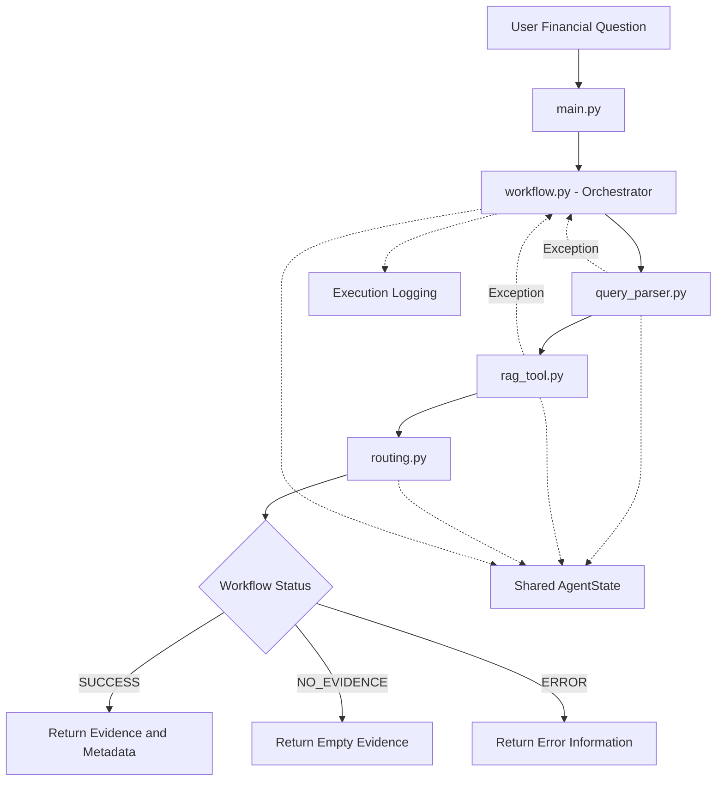

# Agentic Backbone — Architecture v0.1

**Project:** Columbia QMSS x KPMG Financial Document Q&A

**Target Demo:** October 22, 2026

**Architecture:** Rule-based Single-Agent Workflow

**Implementation:** Plain Python

## 1. Objective

Build a working single-agent workflow that accepts a
financial question, extracts filters, retrieves mock
financial evidence, and returns evidence with source
metadata and execution status.

The MVP does not generate LLM-based answers.

## 2. Architecture Diagram



## 3. Workflow Steps

1. Receive user financial question and top_k.
2. Create an initial AgentState.
3. Parse query and extract financial filters.
4. Store filters in AgentState.
5. Call the RAG retrieval adapter.
6. Store retrieved evidence and source metadata.
7. Determine status using conditional routing.
8. Record execution events.
9. Return final AgentState.

If query parsing or retrieval raises an exception,
the orchestrator records the error and routes to ERROR.

## 4. Module Ownership

| Module | File | Owner |
|---|---|---|
| Query Understanding | agent/query_parser.py | Jixuan Liu |
| RAG Tool Integration | agent/tools/rag_tool.py | Jiahui Yang |
| Conditional Routing | agent/routing.py | Lidan Yu |
| State & Logging | agent/state.py, agent/logging_utils.py | Lingfei Zhang |
| Testing & QA | tests/ | Yichen Liu |
| Workflow Orchestration | agent/workflow.py | Team Leads |
| Entry Point | main.py | Team Leads |

## 5. Shared State

AgentState includes:

- query
- filters
- top_k
- evidence
- status
- error
- logs

Defined in agent/state.py.

## 6. Status Definitions

- PENDING: Workflow has not completed.
- SUCCESS: Retrieval completed with evidence.
- NO_EVIDENCE: Retrieval completed without evidence.
- ERROR: Query parsing or retrieval failed.

Error status takes priority over available evidence.

## 7. External Dependency

RAG Team contract:

```python
retrieve(
    query: str,
    filters: dict | None = None,
    top_k: int = 10
) -> list[RetrievedChunk]
```

Agent Team adapter:

```python
retrieve_evidence(
    query: str,
    filters: dict | None = None,
    top_k: int = 10
) -> list[dict]
```

The MVP uses the existing mock retriever.

The exact RetrievedChunk schema and Python import path
must be confirmed with the RAG Team.

## 8. Error Handling

The workflow catches query parsing and retrieval
exceptions and stores the error message in AgentState.

Routing determines the final status.

No silent failures are permitted.

## 9. Testing

Minimum demo scenarios:

1. Microsoft Q3 FY2026 -> SUCCESS
2. Microsoft FY2025 -> NO_EVIDENCE
3. Invalid top_k = 0 -> ERROR

All tests must run without external API credentials.

## 10. Out of Scope

- LLM answer generation
- Multi-agent collaboration
- GraphRAG
- SQL tools
- Persistent session memory
- Advanced conversation management

## 11. Future Extensions

The modular architecture may support additional tools,
LangGraph orchestration, and multi-agent workflows
after MVP validation.
```
