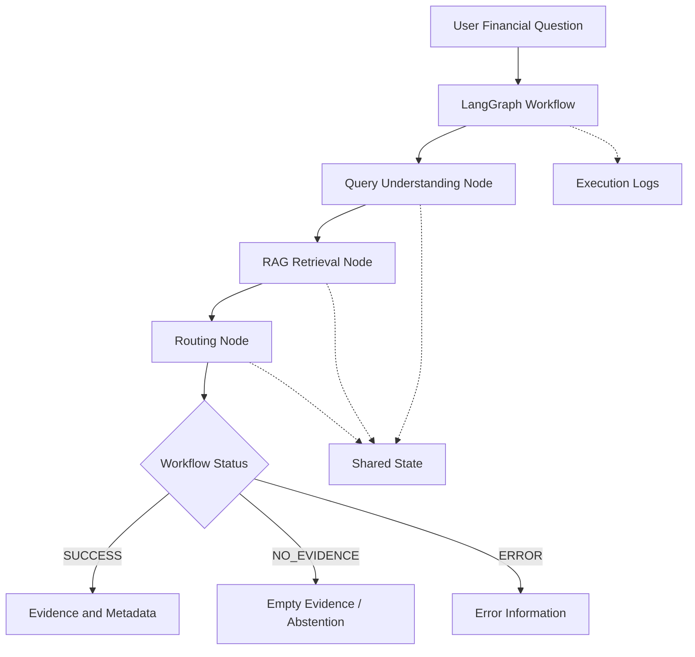
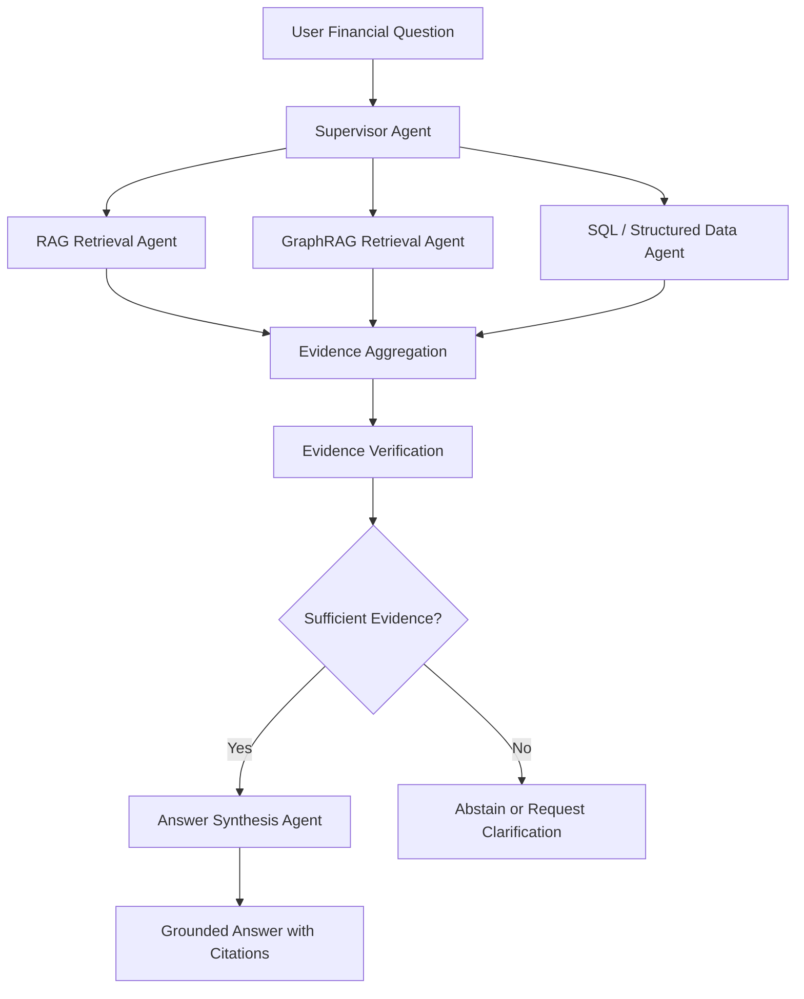

# Agentic Backbone — Architecture v0.2

**Project:** Columbia QMSS × KPMG Financial Document Q&A  
**Updated:** October 15, 2026  
**Target MVP Demo:** October 22, 2026  
**Target Framework:** LangGraph + Python  
**Long-Term Direction:** Hierarchical Multi-Agent Architecture  
**Current Status:** LangChain mock workflow tested; LangGraph migration and real retrieval integration pending.

---

## 1. Project Objective

The Agentic Backbone Team is responsible for building the orchestration layer that connects user financial questions with retrieval tools and returns traceable financial evidence.

Our responsibilities include:

1. Query Understanding
2. Tool Calling and Routing
3. RAG / GraphRAG Retrieval Integration
4. Shared State Management
5. Evidence and Source Metadata Handling
6. Error Handling and Abstention
7. Execution Logging and Testing

Following KPMG's feedback on October 15, we are moving toward a LangGraph-based architecture that can eventually support multiple specialized agents.

However, our immediate priority is to deliver a stable and testable MVP before expanding the system.

---

## 2. Two Development Stages

### Stage 1 — October 22 MVP

**Goal:** Deliver a working financial-question retrieval workflow using LangGraph.

The minimum workflow should:

1. Accept a financial question.
2. Extract financial filters.
3. Call the RAG retrieval interface.
4. Return retrieved evidence with source metadata.
5. Determine the appropriate workflow status.
6. Record execution logs and tool calls.
7. Handle retrieval errors and empty results.
8. Run automated tests.

The MVP should use the real RAG retriever if integration succeeds, with the existing mock retriever retained as a fallback.

**Required output:**

- Retrieved evidence
- Source metadata
- Workflow status
- Execution logs
- Error information, when applicable

**Not required for the October 22 MVP:**

- Multiple autonomous LLM agents
- LLM-based answer generation
- Live GraphRAG integration
- SQL tool integration
- Fully connected UI
- Persistent conversation memory

### Stage 2 — Future Multi-Agent Architecture

**Goal:** Expand the MVP into a hierarchical multi-agent system using LangGraph.

The future system may include:

- A Supervisor Agent for coordination
- A RAG Retrieval Agent
- A GraphRAG Retrieval Agent
- A structured-data / SQL Agent
- An Answer Synthesis Agent

The exact number and responsibilities of agents will depend on business use cases and technical evaluation.

The system should support:

1. Intelligent task delegation
2. Conditional tool selection
3. Multi-step retrieval
4. Evidence aggregation
5. Source verification
6. Grounded answer generation
7. Abstention when evidence is insufficient
8. Multi-agent execution tracing

These are planned architectural capabilities, not features already implemented.

---

## 3. October 22 MVP Architecture



### MVP Execution Flow

1. Initialize shared workflow state.
2. Parse user query and extract financial filters.
3. Call the RAG retrieval adapter.
4. Store retrieved evidence and metadata.
5. Apply conditional routing.
6. Record tool calls and execution events.
7. Return final state.

### LangGraph Implementation Direction

The workflow will use:

- **StateGraph:** Define the workflow structure.
- **Nodes:** Execute individual tasks.
- **Edges:** Connect workflow components.
- **Conditional Edges:** Determine next steps based on state.
- **Shared State:** Transfer information across nodes.

LangGraph migration will be owned by the Team Leads.

Individual module owners should implement reusable Python functions rather than building separate agent graphs.

---

## 4. Future Hierarchical Multi-Agent Architecture



### Proposed Agent Responsibilities

| Agent | Responsibility |
|---|---|
| Supervisor Agent | Understand the task and coordinate specialized agents |
| RAG Retrieval Agent | Retrieve relevant SEC filing text and tables |
| GraphRAG Retrieval Agent | Retrieve entity relationships and graph evidence |
| SQL / Structured Data Agent | Retrieve structured financial facts |
| Answer Synthesis Agent | Generate grounded answers from verified evidence |

This is a proposed target architecture.

It does not imply that each user persona requires a separate agent.

The final agent structure should be confirmed against KPMG's business requirements and evaluation results.

---

## 5. Module Ownership

Our five existing workstreams remain unchanged during the initial LangGraph migration.

| Module | File | Owner |
|---|---|---|
| Query Understanding | `agent/query_parser.py` | Jixuan Liu |
| RAG Tool Integration | `agent/tools/rag_tool.py` | Jiahui Yang |
| Conditional Routing | `agent/routing.py` | Lidan Yu |
| State & Logging | `agent/state.py`, `agent/logging_utils.py` | Lingfei Zhang |
| Testing & QA | `tests/` | Yichen Liu |
| LangGraph Orchestration | `agent/workflow.py` | Team Leads |
| Entry Point | `main.py` | Team Leads |

### Development Principle

Each module should expose a clearly defined Python function.

The Team Leads will connect these functions as LangGraph nodes.

Module owners should not independently modify the overall workflow architecture or shared-state schema.

Changes to function contracts must be approved before implementation.

---

## 6. Shared State

The current `AgentState` includes:

- `query`
- `filters`
- `top_k`
- `evidence`
- `status`
- `error`
- `logs`

The existing state is defined in `agent/state.py`.

### LangGraph Migration

The Team Leads will adapt the existing state to a LangGraph-compatible schema.

The target state must preserve the same core information so that existing module functions remain reusable.

Possible future extensions include:

- `selected_tools`
- `tool_results`
- `agent_messages`
- `answer`
- `citations`
- `execution_trace`

These extensions are not required for the initial MVP.

### State Ownership

| State Field | Responsible Module |
|---|---|
| `query`, `top_k` | Workflow / Entry Point |
| `filters` | Query Understanding |
| `evidence` | Retrieval Integration |
| `status` | Conditional Routing |
| `error` | Workflow Error Handling |
| `logs` | Execution Logging |

Shared-state changes must be coordinated through the Team Leads.

---

## 7. Status and Error Handling

The MVP uses four workflow statuses:

| Status | Meaning |
|---|---|
| `PENDING` | Workflow has not finished |
| `SUCCESS` | Retrieval completed with evidence |
| `NO_EVIDENCE` | Retrieval completed without evidence |
| `ERROR` | Parsing, retrieval, or workflow execution failed |

### MVP Routing Rules

1. If an execution error exists, return `ERROR`.
2. Otherwise, if evidence is returned, use `SUCCESS`.
3. Otherwise, return `NO_EVIDENCE`.

An error takes priority over partial evidence.

### Future Evidence Verification

For the future multi-agent system, receiving evidence is not necessarily sufficient to answer a question.

The Agent should eventually evaluate whether evidence:

- Answers the specific question
- Matches the requested company and period
- Contains sufficient supporting information
- Has valid citations
- Contains conflicting or outdated financial facts

If evidence is insufficient, the system should abstain rather than invent an answer.

Evidence-sufficiency evaluation is a future extension beyond the initial routing rules.

---

## 8. RAG Integration

### Upstream RAG Interface

The agreed retrieval interface is:

```python
retrieve(
    query: str,
    filters: dict | None = None,
    top_k: int = 10
) -> list[RetrievedChunk]
```

The RAG Team has reported that its retrieval contract has been merged and the retriever is wrapped as a LangChain tool.

The Agent Team must still validate the actual code and returned payload in our environment.

### Agent-Side Adapter

Our internal adapter remains:

```python
retrieve_evidence(
    query: str,
    filters: dict | None = None,
    top_k: int = 10
) -> list[dict]
```

The adapter will:

1. Call the upstream retriever.
2. Pass company and period filters.
3. Convert retrieved chunks into our internal evidence format.
4. Preserve available source metadata and citations.
5. Return an empty list when appropriate.
6. Propagate unexpected retrieval errors.

### Integration Requirements

Confirm with the RAG Team:

- Callable Python import path
- Input parameter compatibility
- `RetrievedChunk` fields and types
- Source IDs and citation metadata
- Company and fiscal-period filtering
- Empty results and exception handling
- Required environment dependencies

The retrieval adapter must remain independent of the LangGraph orchestration logic.

---

## 9. GraphRAG Integration — Future Phase

The GraphRAG Team is responsible for developing the knowledge graph and graph-based retrieval capabilities.

Our Agentic Backbone Team is responsible for orchestrating the GraphRAG tool once available.

### Collaboration Areas

1. Align GraphRAG API with the retrieval contract.
2. Determine when graph retrieval is useful.
3. Design routing between RAG and GraphRAG.
4. Normalize graph evidence and source metadata.
5. Handle missing relationships and conflicting evidence.
6. Test graph retrieval with shared evaluation questions.

GraphRAG is not a required dependency for the October 22 MVP.

The current GraphRAG proof of concept uses dummy data. Real graph retrieval integration will be a later milestone.

---

## 10. UI Integration

The Business / UI Team has developed an initial Financial Explorer HTML prototype.

The current prototype contains scripted responses and illustrative financial data, rather than a live connection to our Agent.

### Required Interface Alignment

The teams should agree on:

**Frontend Request:**

- User question
- Optional company or period context
- Future session information, if needed

**Agent Response:**

- Workflow status
- Evidence
- Source metadata and citations
- Error or no-evidence information
- Generated answer, when LLM generation is implemented

### Initial UI Integration Goal

Define and validate a request / response contract.

A complete frontend-to-backend connection is not required for October 22, but should be included in the next integration plan.

---

## 11. Execution Logging

KPMG specifically requested that tool-calling sequences be tracked when adopting LangGraph.

The MVP should log:

- Workflow start and completion
- Query parsing events
- Retrieval tool calls
- Tool execution results
- Routing decisions
- Errors
- Final workflow status

Example:

```text
[INFO] Workflow started
[INFO] Query parsing started
[INFO] Query parsing completed
[INFO] RAG retrieval started
[INFO] RAG retrieval completed
[INFO] Workflow status: SUCCESS
```

The future multi-agent architecture should extend logging to record:

- Selected agent
- Selected tool
- Invocation order
- Execution outcome
- Retry attempts
- Final response path

Sensitive credentials must never be included in logs.

---

## 12. Testing and Evaluation

### October 22 MVP Tests

Minimum scenarios:

1. Successful retrieval with financial filters
2. No evidence returned
3. Invalid retrieval parameter or tool failure

Expected statuses:

- `SUCCESS`
- `NO_EVIDENCE`
- `ERROR`

Tests should verify:

- Financial filter extraction
- Correct retrieval function calls
- Evidence and source metadata preservation
- Conditional routing
- Error handling
- Execution logging
- Consistent workflow state

Existing deterministic mock tests should remain available.

Where the real RAG retriever is available, conduct a separate integration test using actual SEC filing evidence.

### Future Evaluation

Coordinate with the Evaluation Team on:

- Query filter accuracy
- Retrieval relevance
- Tool routing accuracy
- Evidence sufficiency
- Citation correctness
- Abstention behavior
- Multi-step question handling

---

## 13. Development Timeline

| Date | Milestone | Expected Deliverable |
|---|---|---|
| Oct 15–16 | Architecture revision | LangGraph architecture and updated contracts |
| Oct 19 | Member implementations | Initial module PRs and RAG adapter feedback |
| Oct 20 | Integration | First integrated workflow |
| Oct 21 | Testing | Regression tests and bug fixes |
| Oct 22 | MVP Demo | Working workflow with evidence, status, metadata, and logs |

The team should prioritize a stable executable MVP over implementing every part of the future architecture.

---

## 14. Scope and Priorities

### Priority 0 — October 22 MVP

- LangGraph workflow migration
- Query parsing
- RAG tool integration
- Conditional routing
- Shared state
- Execution logging
- Automated testing

### Priority 1 — Interface Alignment

- GraphRAG API planning
- UI request / response contract
- Evaluation test cases
- Evidence and citation normalization

### Priority 2 — Future Development

- Hierarchical multi-agent orchestration
- Additional retrieval tools
- LLM-based answer synthesis
- Advanced evidence verification
- Persistent chat history
- Production deployment

---

## 15. Design Principles

1. **Build end-to-end first.** Prioritize a working system before expanding complexity.
2. **Keep modules reusable.** Retrieval and parsing logic should not depend directly on the orchestration framework.
3. **Preserve traceability.** Evidence should retain source metadata and citation identifiers.
4. **Handle uncertainty.** The system should distinguish missing evidence from tool errors.
5. **Make execution observable.** Record routing decisions and tool-calling sequences.
6. **Extend incrementally.** Add specialized agents only when justified by use cases and evaluation.
7. **Maintain backward compatibility when practical.** Existing tested Python components should be reused during migration.

---

## 16. Current Implementation Status

As of October 15, 2026:

**Completed:**

- Original single-agent architecture
- GitHub repository structure
- Initial shared-state implementation
- Initial function contracts
- LangChain Core workflow skeleton
- Mock retrieval workflow tests

**Planned or in progress:**

- LangGraph migration
- Updated function contracts
- Five module implementations
- Real RAG retriever integration
- UI interface alignment
- Full multi-agent architecture design

**Not yet implemented:**

- Hierarchical multi-agent execution
- Live GraphRAG integration
- SQL tool integration
- LLM answer generation
- Production UI-to-Agent API

The architecture will evolve through integration testing and feedback from KPMG and partner teams.
