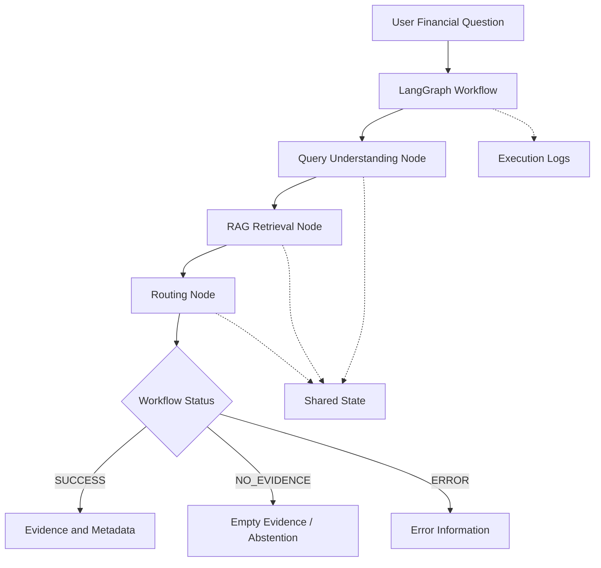
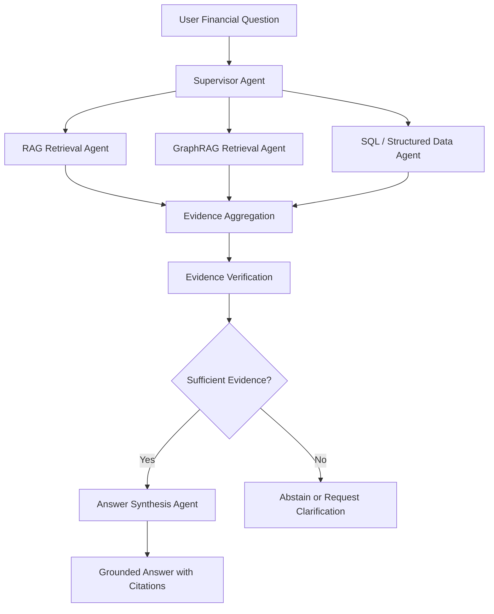

# Agentic Backbone — Architecture v0.2 中文版

**项目：** Columbia QMSS × KPMG Financial Document Q&A  
**更新日期：** 2026年10月15日  
**MVP Demo 截止日期：** 2026年10月22日  
**目标技术框架：** LangGraph + Python  
**长期技术方向：** Hierarchical Multi-Agent Architecture（分层多智能体架构）  
**当前状态：** LangChain Mock Workflow 已测试通过；LangGraph 迁移和真实 RAG 接入尚未完成。

---

## 1. Project Objective — 项目目标

Agentic Backbone Team 负责整个系统的 **Orchestration Layer（工作流编排层）**。

我们的任务是将用户提出的金融问题连接到不同的 Retrieval Tools（检索工具），并返回可追溯来源的金融证据。

我们负责以下七个部分：

1. **Query Understanding（问题理解）**：识别用户的问题及金融筛选条件。
2. **Tool Calling and Routing（工具调用与路由）**：决定调用哪些工具。
3. **RAG / GraphRAG Retrieval Integration（检索工具集成）**：连接其他团队提供的检索系统。
4. **Shared State Management（共享状态管理）**：维护工作流执行过程中的信息。
5. **Evidence and Source Metadata Handling（证据及来源处理）**：保存检索结果及其出处。
6. **Error Handling and Abstention（错误处理与拒答）**：处理异常以及证据不足的情况。
7. **Execution Logging and Testing（执行日志与测试）**：记录流程并验证结果。

根据 KPMG 10月15日的反馈，我们计划转向 **LangGraph-based Architecture**，并逐步支持多个 Specialized Agents（专业智能体）。

但是，当前首要目标仍然是先完成稳定、可测试的 MVP，而不是立即实现复杂的 Multi-Agent System。

---

## 2. Two Development Stages — 两阶段开发规划

### Stage 1 — October 22 MVP

**目标：** 使用 LangGraph 实现一个可运行的金融问题检索工作流。

MVP 至少应该能够：

1. 接收用户提出的金融问题。
2. 解析问题并提取 Financial Filters。
3. 调用 RAG Retrieval Interface。
4. 返回包含来源 Metadata 的 Evidence。
5. 判断 Workflow Status。
6. 记录 Execution Logs 和 Tool Calls。
7. 处理检索失败及空结果。
8. 运行自动化测试。

如果真实 RAG Retriever 成功接入，优先使用真实版本。

如果集成出现问题，保留现有 Mock Retriever 作为备用方案。

**必须返回的内容：**

- Retrieved Evidence（检索证据）
- Source Metadata（来源信息）
- Workflow Status（执行状态）
- Execution Logs（执行日志）
- Error Information（错误信息，如有）

**Oct 22 MVP 暂时不要求：**

- 多个自主运行的 LLM Agents
- LLM Answer Generation
- 真实 GraphRAG Integration
- SQL Tool Integration
- 完整 UI Integration
- Persistent Conversation Memory（持久化对话记忆）

### Stage 2 — Future Multi-Agent Architecture

**目标：** 将初版 MVP 扩展成基于 LangGraph 的分层多智能体系统。

未来可能包含：

- **Supervisor Agent**：统筹任务并协调其他 Agents。
- **RAG Retrieval Agent**：负责文档检索。
- **GraphRAG Retrieval Agent**：负责实体关系检索。
- **SQL / Structured Data Agent**：负责结构化财务数据查询。
- **Answer Synthesis Agent**：负责整合证据并生成答案。

具体需要多少个 Agent、每个 Agent 做什么，需要根据 Business Use Cases 和 Evaluation Results 决定。

未来系统希望支持：

1. Intelligent Task Delegation（智能任务分配）
2. Conditional Tool Selection（条件工具选择）
3. Multi-step Retrieval（多步检索）
4. Evidence Aggregation（证据聚合）
5. Source Verification（来源验证）
6. Grounded Answer Generation（基于证据生成答案）
7. Abstention（证据不足时拒答）
8. Multi-Agent Execution Tracing（多智能体执行追踪）

以上属于未来规划，不代表目前已经实现。

---

## 3. October 22 MVP Architecture — MVP 架构



### MVP Execution Flow — 执行步骤

1. 初始化 Shared State。
2. 解析用户问题并提取金融筛选条件。
3. 调用 RAG Retrieval Adapter。
4. 保存检索证据和来源 Metadata。
5. 执行 Conditional Routing。
6. 记录工具调用和执行事件。
7. 返回最终 State。

### LangGraph Implementation Direction — 技术实现方式

我们将使用以下 LangGraph 组件：

- **StateGraph**：定义整个 Workflow。
- **Nodes（节点）**：执行各个独立任务。
- **Edges（边）**：连接不同节点。
- **Conditional Edges（条件边）**：根据 State 判断下一步执行哪个节点。
- **Shared State（共享状态）**：在节点之间传递信息。

**LangGraph 迁移由 Team Leads 负责。**

各位组员主要负责开发可复用的 Python Functions，不需要各自搭建单独的 Agent Graph。

---

## 4. Future Hierarchical Multi-Agent Architecture — 未来多智能体架构



### Proposed Agent Responsibilities — 计划中的职责

| Agent | 职责 |
|---|---|
| Supervisor Agent | 理解任务并协调不同专业 Agent |
| RAG Retrieval Agent | 检索 SEC Filings 的相关文字和表格 |
| GraphRAG Retrieval Agent | 检索实体关系和图谱证据 |
| SQL / Structured Data Agent | 查询结构化财务数据 |
| Answer Synthesis Agent | 根据经过验证的 Evidence 生成答案 |

注意：

这是未来的目标架构，并非已经实现的系统。

**User Persona 不等于 Agent。**

即使最终只服务一种用户 Persona，也可以有多个内部 Agents；最终分工应根据 KPMG 的业务需求和评估结果确认。

---

## 5. Module Ownership — 小组分工

在最初的 LangGraph 迁移中，我们保留现有五个 Workstreams 的分工。

| Module | File | Owner |
|---|---|---|
| Query Understanding | `agent/query_parser.py` | Jixuan Liu |
| RAG Tool Integration | `agent/tools/rag_tool.py` | Jiahui Yang |
| Conditional Routing | `agent/routing.py` | Lidan Yu |
| State & Logging | `agent/state.py`, `agent/logging_utils.py` | Lingfei Zhang |
| Testing & QA | `tests/` | Yichen Liu |
| LangGraph Orchestration | `agent/workflow.py` | Team Leads |
| Entry Point | `main.py` | Team Leads |

### Development Principle — 开发原则

每个模块应该提供明确的 Python Function。

Team Leads 负责将这些 Functions 连接成 LangGraph Nodes。

组员不需要独立修改整个 Workflow Architecture，也不能自行更改 Shared State Schema。

如果需要修改 Function Contracts，必须先与 Team Leads 沟通确认。

---

## 6. Shared State — 共享状态

当前 `AgentState` 包含以下字段：

- `query`：用户原始问题
- `filters`：解析出的金融筛选条件
- `top_k`：Retriever 最多返回多少个结果
- `evidence`：检索证据
- `status`：执行状态
- `error`：错误信息
- `logs`：执行日志

当前 State 在 `agent/state.py` 中定义。

### LangGraph Migration — 状态迁移

Team Leads 会将现有 State 调整成兼容 LangGraph 的 Schema。

迁移时必须保留核心信息，避免组员已经开发的 Functions 无法复用。

未来可能新增：

- `selected_tools`：本次选择的工具
- `tool_results`：工具调用结果
- `agent_messages`：不同 Agent 的消息
- `answer`：最终生成的答案
- `citations`：引用来源
- `execution_trace`：完整执行轨迹

这些新增字段暂时不是初版 MVP 的强制要求。

### State Ownership — 字段负责人

| State Field | Responsible Module |
|---|---|
| `query`, `top_k` | Workflow / Entry Point |
| `filters` | Query Understanding |
| `evidence` | Retrieval Integration |
| `status` | Conditional Routing |
| `error` | Workflow Error Handling |
| `logs` | Execution Logging |

所有 Shared State 的结构变动都应由 Team Leads 统一协调。

---

## 7. Status and Error Handling — 状态与错误处理

MVP 使用四种 Workflow Status：

| Status | 含义 |
|---|---|
| `PENDING` | 工作流尚未完成 |
| `SUCCESS` | 成功检索到 Evidence |
| `NO_EVIDENCE` | 检索完成，但没有返回 Evidence |
| `ERROR` | Query Parsing、Retrieval 或 Workflow 执行失败 |

### MVP Routing Rules — 路由规则

1. 如果存在执行错误，返回 `ERROR`。
2. 如果没有错误且返回了 Evidence，返回 `SUCCESS`。
3. 如果没有错误且没有 Evidence，返回 `NO_EVIDENCE`。

如果同时存在部分 Evidence 和 Error，优先返回 `ERROR`。

### Future Evidence Verification — 未来证据验证

未来 Multi-Agent 系统不能简单地认为“有 Evidence 就一定可以回答问题”。

Agent 应进一步判断：

- Evidence 是否真正回答了用户问题？
- Company 和 Fiscal Period 是否正确？
- 支撑信息是否充分？
- Citations 是否有效？
- 是否存在相互矛盾或过时的财务数据？

如果证据不足，系统应当 Abstain（拒答或说明无法确认），不能编造答案。

这一能力属于后续扩展，而非当前 MVP 的简单 Routing Rules。

---

## 8. RAG Integration — RAG 工具集成

### Upstream RAG Interface — RAG 组提供的接口

双方约定的接口：

```python
retrieve(
    query: str,
    filters: dict | None = None,
    top_k: int = 10
) -> list[RetrievedChunk]
```

RAG Team 已报告其 Retrieval Contract 已合并，并将 Retriever 封装为 LangChain Tool。

但我们仍需要在自己的环境中验证其真实代码、依赖和返回结果。

### Agent-Side Adapter — 我们内部的适配器

```python
retrieve_evidence(
    query: str,
    filters: dict | None = None,
    top_k: int = 10
) -> list[dict]
```

Adapter 负责：

1. 调用 RAG 组的 Retriever。
2. 传递 Company / Fiscal Period Filters。
3. 将结果转换成我们内部统一的 Evidence 格式。
4. 保留来源 Metadata 和 Citations。
5. 在无结果时返回空列表。
6. 对非预期错误进行异常传递。

### Integration Requirements — 集成前需要确认

- Python Import Path（如何导入 Retriever）
- Input Parameters（输入参数）
- `RetrievedChunk` Fields and Types（返回字段及类型）
- Source IDs 和 Citation Metadata
- Company / Fiscal Period Filtering
- Empty Results 和 Exception Handling
- Environment Dependencies（运行依赖）

RAG Adapter 应与 LangGraph Orchestration 解耦，以方便未来替换检索实现。

---

## 9. GraphRAG Integration — Future Phase

GraphRAG Team 负责开发 Knowledge Graph 和 Graph-based Retrieval。

我们的 Agentic Backbone Team 负责在其接口可用后，将 GraphRAG 作为工具纳入整个 Workflow。

### Collaboration Areas — 需要协作的部分

1. 将 GraphRAG API 与现有 Retrieval Contract 对齐。
2. 判断哪些问题适合 Graph Retrieval。
3. 设计 RAG 与 GraphRAG 的 Routing。
4. 统一 Graph Evidence 和 Metadata 的格式。
5. 处理 Missing Relationships 和 Conflicting Evidence。
6. 使用共同的 Evaluation Questions 测试。

**GraphRAG 不是 Oct 22 MVP 的必要依赖。**

目前 GraphRAG Proof of Concept 使用的是 Dummy Data，真实 GraphRAG 集成将安排在后续阶段。

---

## 10. UI Integration — 前端界面集成

Business / UI Team 已经开发了 Financial Explorer HTML Prototype。

目前该 Prototype 主要是 Scripted Responses 和 Illustrative Financial Data，还没有连接我们的实际 Agent。

### Required Interface Alignment — 需要确认的接口

**Frontend Request（UI → Agent）：**

- User Question
- Optional Company / Period Context
- Future Session Information（如有需要）

**Agent Response（Agent → UI）：**

- Workflow Status
- Evidence
- Source Metadata and Citations
- Error / No-Evidence Information
- Generated Answer（未来接入 LLM 后）

### Initial UI Integration Goal — 初步目标

先确定并验证双方的 Request / Response Contract。

Oct 22 暂时不强制完成完整的 UI-to-Agent Backend Connection，但需要把它纳入后续集成计划。

---

## 11. Execution Logging — 执行日志

KPMG 特别提出，在采用 LangGraph 时应该记录 Tool Calling Sequence（工具调用顺序）。

MVP 应记录：

- Workflow Start / Completion
- Query Parsing Events
- Retrieval Tool Calls
- Tool Execution Results
- Routing Decisions
- Errors
- Final Workflow Status

示例：

```text
[INFO] Workflow started
[INFO] Query parsing started
[INFO] Query parsing completed
[INFO] RAG retrieval started
[INFO] RAG retrieval completed
[INFO] Workflow status: SUCCESS
```

未来的 Multi-Agent 系统应进一步记录：

- Selected Agent（被选中的 Agent）
- Selected Tool（被调用的工具）
- Invocation Order（调用顺序）
- Execution Outcome（执行结果）
- Retry Attempts（重试次数）
- Final Response Path（最终响应路径）

日志中不能记录 API Keys、密码等敏感信息。

---

## 12. Testing and Evaluation — 测试与评估

### October 22 MVP Tests

最低测试要求包括：

1. 有 Financial Filters 的成功检索
2. 没有 Evidence 返回
3. 无效 Retrieval Parameter 或工具失败

对应状态：

- `SUCCESS`
- `NO_EVIDENCE`
- `ERROR`

需要验证：

- Financial Filter Extraction
- Retrieval Function Calling
- Evidence / Metadata Preservation
- Conditional Routing
- Error Handling
- Execution Logging
- Workflow State Consistency

原来已经通过的 Mock Tests 应继续保留。

如果真实 RAG Retriever 可用，应增加独立的 Integration Test，使用实际 SEC Filing Evidence。

### Future Evaluation

未来与 Evaluation Team 一起评估：

- Query Filter Accuracy
- Retrieval Relevance
- Tool Routing Accuracy
- Evidence Sufficiency
- Citation Correctness
- Abstention Behavior
- Multi-step Question Handling

---

## 13. Development Timeline — 开发时间线

| Date | Milestone | Expected Deliverable |
|---|---|---|
| Oct 15–16 | Architecture Revision | LangGraph Architecture 和更新后的 Contracts |
| Oct 19 | Member Implementations | 初版 Module PRs + RAG Adapter Feedback |
| Oct 20 | Integration | 第一次完整 Workflow 集成 |
| Oct 21 | Testing | Regression Tests + Bug Fixes |
| Oct 22 | MVP Demo | 返回 Evidence、Metadata、Status 和 Logs 的可运行 Workflow |

优先保证 MVP 稳定运行，而不是一次完成未来架构的所有功能。

---

## 14. Scope and Priorities — 范围与优先级

### Priority 0 — October 22 MVP

- LangGraph Workflow Migration
- Query Parsing
- RAG Tool Integration
- Conditional Routing
- Shared State
- Execution Logging
- Automated Testing

### Priority 1 — Interface Alignment

- GraphRAG API Planning
- UI Request / Response Contract
- Evaluation Test Cases
- Evidence / Citation Normalization

### Priority 2 — Future Development

- Hierarchical Multi-Agent Orchestration
- Additional Retrieval Tools
- LLM Answer Synthesis
- Advanced Evidence Verification
- Persistent Chat History
- Production Deployment

---

## 15. Design Principles — 设计原则

1. **Build end-to-end first（先跑通完整流程）**：先实现能用的系统，再增加复杂性。
2. **Keep modules reusable（保持模块可复用）**：Parsing 和 Retrieval 不应该与某一种 Orchestration Framework 强绑定。
3. **Preserve traceability（保留可追溯性）**：Evidence 必须保留 Source Metadata 和 Citation IDs。
4. **Handle uncertainty（处理不确定性）**：区分证据缺失和工具执行错误。
5. **Make execution observable（使执行过程可观察）**：记录 Routing Decisions 和 Tool Calling Sequence。
6. **Extend incrementally（渐进扩展）**：只有在业务需求和评估结果支持时才增加 Specialized Agents。
7. **Maintain backward compatibility（尽量保持向后兼容）**：迁移时复用已经测试通过的 Python Components。

---

## 16. Current Implementation Status — 当前项目状态

截至 2026年10月15日：

### Completed — 已完成

- 初版 Single-Agent Architecture
- GitHub Repository Structure
- Initial Shared State
- Initial Function Contracts
- LangChain Core Workflow Skeleton
- Mock Retrieval Workflow Tests

### Planned / In Progress — 计划中或进行中

- LangGraph Migration
- Updated Function Contracts
- Five Module Implementations
- Real RAG Retriever Integration
- UI Interface Alignment
- Full Multi-Agent Architecture Design

### Not Yet Implemented — 尚未实现

- Hierarchical Multi-Agent Execution
- Live GraphRAG Integration
- SQL Tool Integration
- LLM Answer Generation
- Production UI-to-Agent API

接下来，我们会根据 Integration Tests、KPMG Feedback，以及其他团队提供的接口，持续更新这份 Architecture。
